# Chihlee Menu — 菜單網站版型 Templates

餐廳／飲料店點餐網站的 8 種 HTML 版型 + 菜單 Excel 範例。全部公開，任何人都可以直接下載或用網址 fetch。

## 檔案

| 檔案 | 用途 |
|---|---|
| `templates/*.html` | 8 種版型，用瀏覽器打開就能看樣子、測試點餐 |
| `menu-sample.xlsx` | 菜單範例，照這個格式填自己的菜單 |
| `screenshots/*.png` | 每個版型的電腦版／手機版截圖 |

### 8 種版型

| 版型 | 檔案 | 風格 | 適合 |
|---|---|---|---|
| 極簡白 Minimal | [`minimal.html`](templates/minimal.html) | 白底黑字、右側小圖 | 咖啡店、早午餐 |
| 夜色酒吧 Night Bar | [`nightbar.html`](templates/nightbar.html) | 深色、金色、大圖卡片 | 酒吧、餐酒館、燒肉 |
| 法式小館 Bistro | [`bistro.html`](templates/bistro.html) | 米色紙、襯線字、不放照片 | 沒有照片的店 |
| 手搖飲 Bubble Tea | [`bubbletea.html`](templates/bubbletea.html) | 粉嫩、圓角、雙欄大圖 | 手搖飲、甜點、冰店 |
| 黑板手寫 Chalkboard | [`chalkboard.html`](templates/chalkboard.html) | 綠黑板、手寫字 | 小吃、早餐店、居酒屋 |
| 海邊咖啡 Seaside Lite | [`seaside.html`](templates/seaside.html) | 背景照片、左側分類欄 | 度假風、咖啡廳 |
| 和風墨色 Sumi | [`sumi.html`](templates/sumi.html) | 白紙黑墨、紅印章、編號 | 拉麵、定食、日式甜點 |
| 經典海邊 Classic | [`classic.html`](templates/classic.html) | 原本的完整版（Tailwind） | 想要原版的人 |

前 7 種是輕量版（約 45 KB），共用同一套點餐程式；Classic 約 100 KB。

## 版型預覽 Screenshots

| 版型 | 電腦 Desktop | 手機 Mobile |
|---|---|---|
| **極簡白 Minimal**<br>[`minimal.html`](templates/minimal.html) | 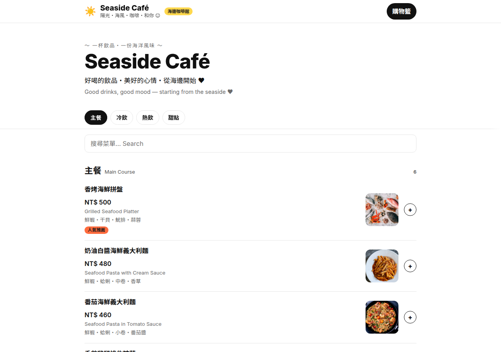 | 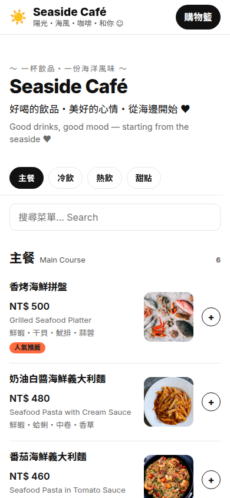 |
| **夜色酒吧 Night Bar**<br>[`nightbar.html`](templates/nightbar.html) | 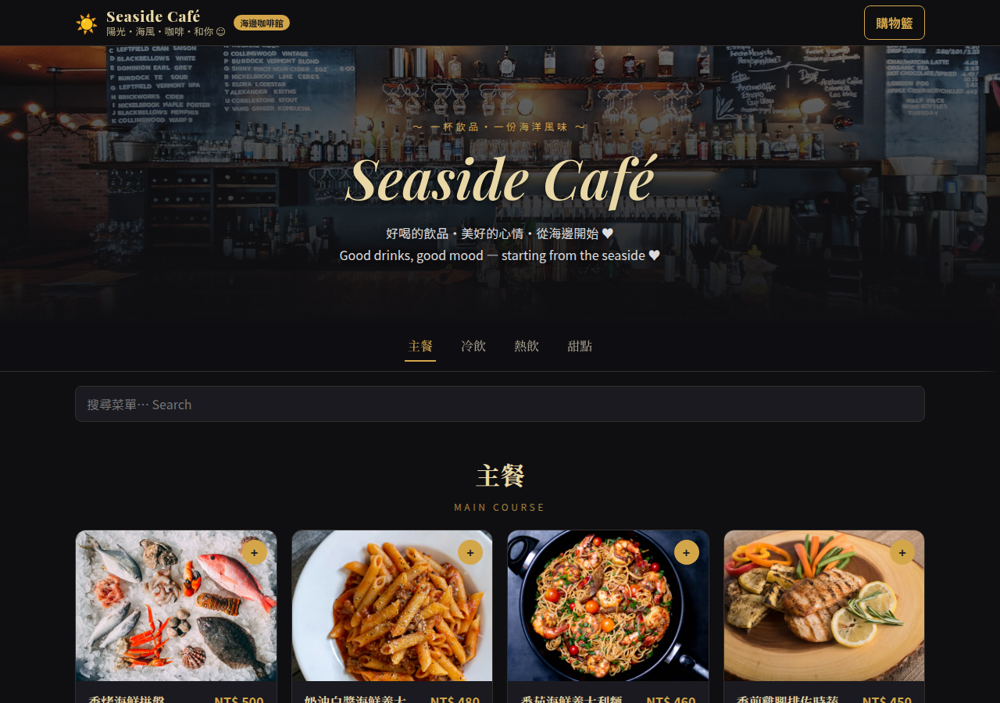 | 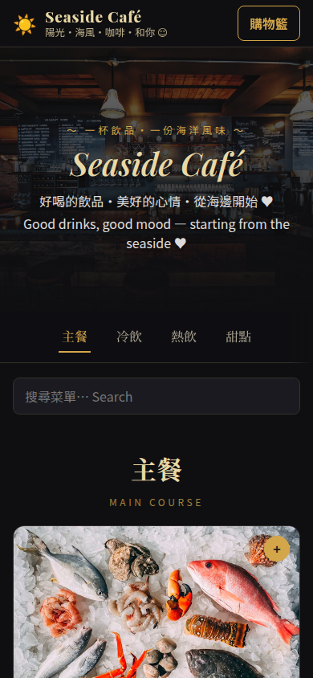 |
| **法式小館 Bistro**<br>[`bistro.html`](templates/bistro.html) | 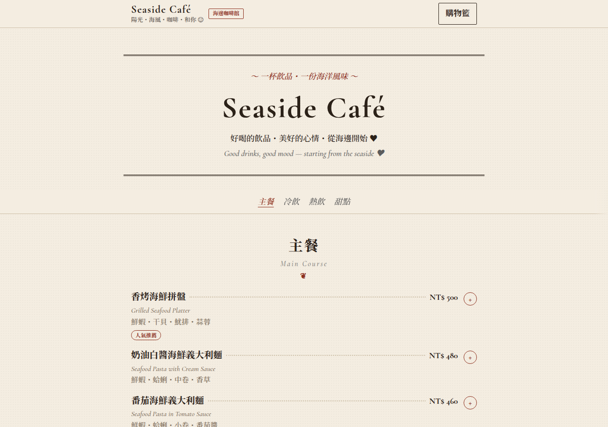 | 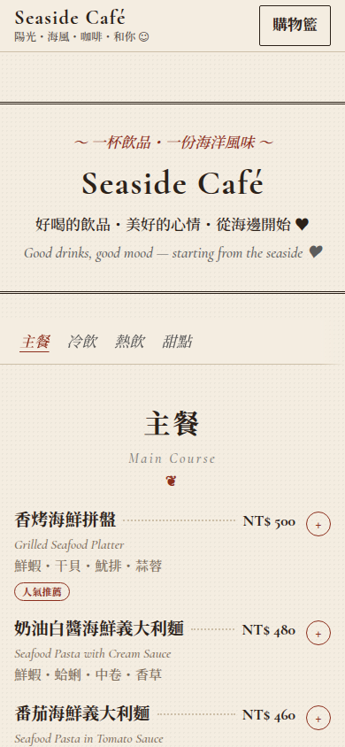 |
| **手搖飲 Bubble Tea**<br>[`bubbletea.html`](templates/bubbletea.html) | 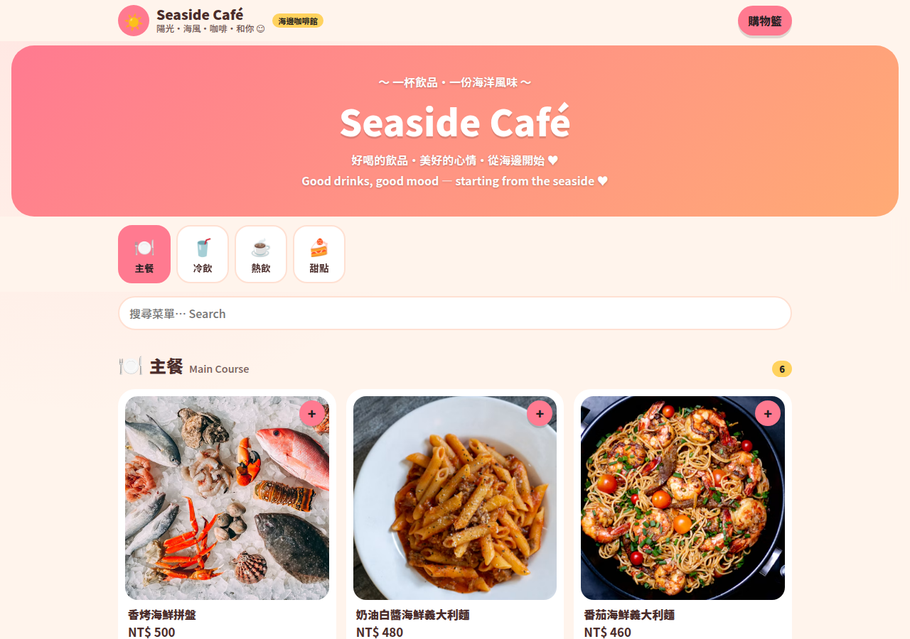 | 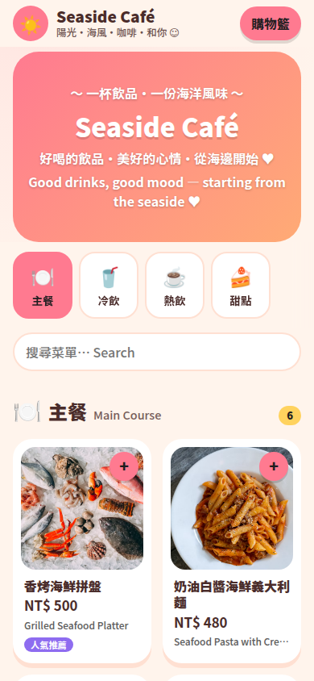 |
| **黑板手寫 Chalkboard**<br>[`chalkboard.html`](templates/chalkboard.html) | 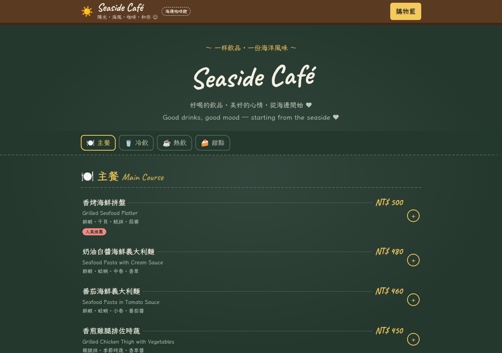 | 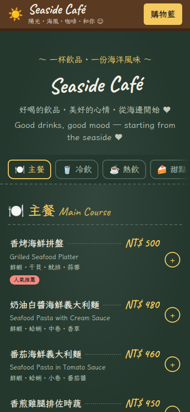 |
| **海邊咖啡 Seaside Lite**<br>[`seaside.html`](templates/seaside.html) | 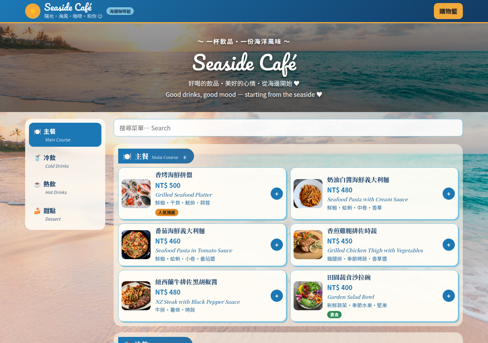 | 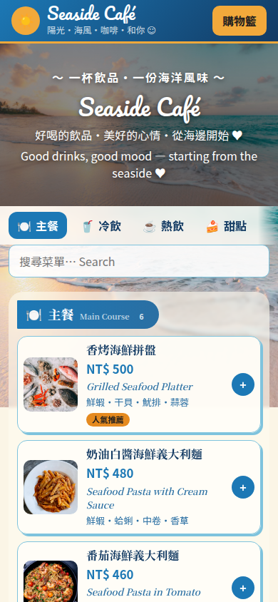 |
| **和風墨色 Sumi**<br>[`sumi.html`](templates/sumi.html) | 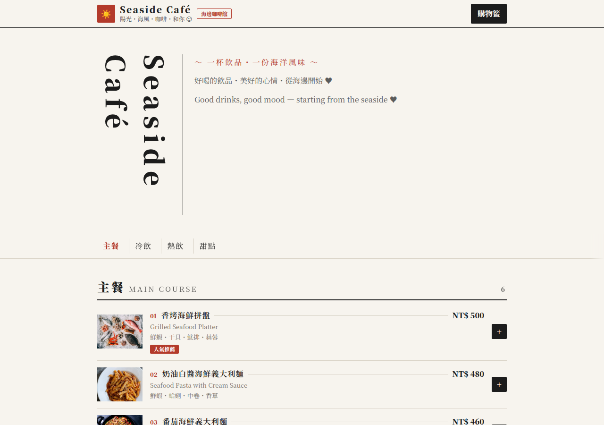 | 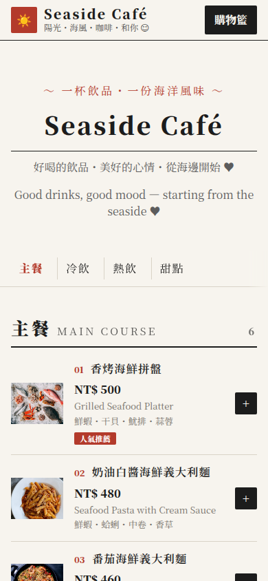 |
| **經典海邊 Classic**<br>[`classic.html`](templates/classic.html) | 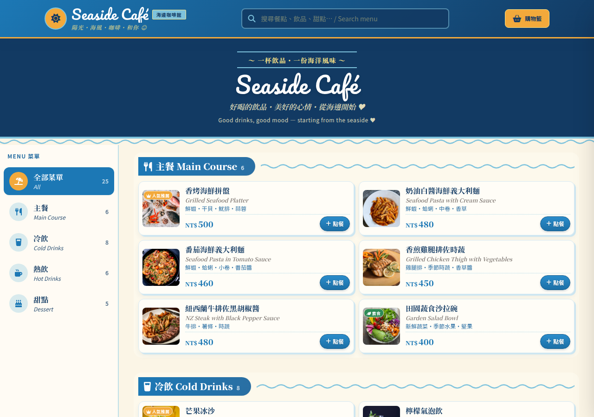 | 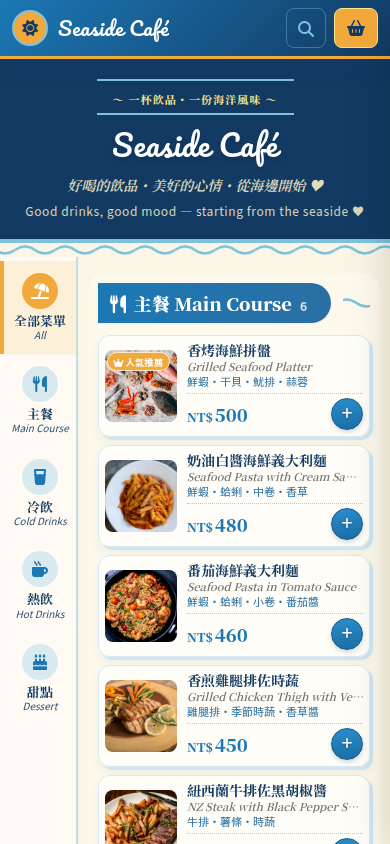 |

## 直接取用（Raw 網址）

```
https://raw.githubusercontent.com/kiendnk-maker/chihlee-menu/main/menu-sample.xlsx
https://raw.githubusercontent.com/kiendnk-maker/chihlee-menu/main/templates/minimal.html
https://raw.githubusercontent.com/kiendnk-maker/chihlee-menu/main/templates/nightbar.html
https://raw.githubusercontent.com/kiendnk-maker/chihlee-menu/main/templates/bistro.html
https://raw.githubusercontent.com/kiendnk-maker/chihlee-menu/main/templates/bubbletea.html
https://raw.githubusercontent.com/kiendnk-maker/chihlee-menu/main/templates/chalkboard.html
https://raw.githubusercontent.com/kiendnk-maker/chihlee-menu/main/templates/seaside.html
https://raw.githubusercontent.com/kiendnk-maker/chihlee-menu/main/templates/sumi.html
https://raw.githubusercontent.com/kiendnk-maker/chihlee-menu/main/templates/classic.html
```

例如：

```bash
curl -O https://raw.githubusercontent.com/kiendnk-maker/chihlee-menu/main/templates/minimal.html
```

```js
const html = await (await fetch('https://raw.githubusercontent.com/kiendnk-maker/chihlee-menu/main/templates/minimal.html')).text();
```

整包下載：<https://github.com/kiendnk-maker/chihlee-menu/archive/refs/heads/main.zip>

## 菜單 Excel 格式

`menu-sample.xlsx` 欄位：

`分類` ｜ `品名` ｜ `英文名` ｜ `價格` ｜ `說明` ｜ `標籤` ｜ `圖片`

- 「圖片」可填網址，或填照片檔名（例如 `latte.jpg`）。
- 分類名稱建議寫成「中文 英文」，例如 `冷飲 Cold Drinks`。

## 版型結構（給要自己改設計的人／AI）

每個版型的內容都由檔案裡的 JSON 產生，改設計時請遵守：

1. 保留 `<script id="site-config" type="application/json">` 區塊；店名、菜單、顏色、背景都在這裡，不要把菜單寫死在 HTML。
2. 最後的 `<script id="engine">` 是點餐程式，原封不動保留。
3. 不要刪除或改名這些 id：`brandName brandSub brandBadge cartBtn cartText cats search menu heroTagline heroTitle heroText1 heroText2 tableNote footerName footerText1 footerText2 copyright`
4. 設計主要改 `<style id="theme">`（品項 class：`.sec .sec-title .items .item .item-img .item-body .item-title .item-price .item-sub .item-desc .tags .tag .item-add`）。
5. 顏色用 CSS 變數：`var(--primary) var(--accent) var(--bg) var(--card) var(--highlight) var(--line) var(--ink)`，不要寫死色碼。

## 上線（免費）

把版型改好、存成 `index.html`，放進一個資料夾，拖到 <https://app.netlify.com/drop> 就有網址。也可以用 GitHub Pages。
